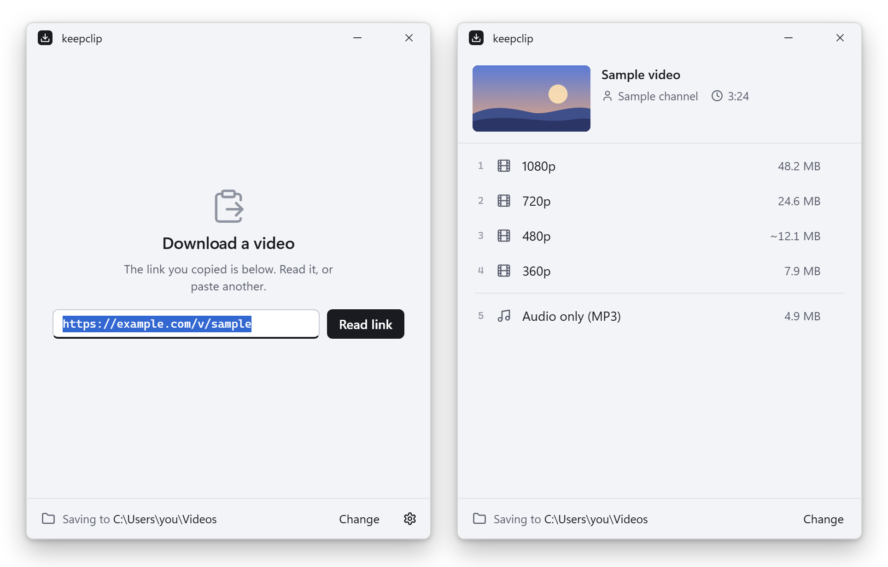

# keepclip

**Save a video from a copied link, on Windows, with yt-dlp doing the work.**

[](https://github.com/iglesiaskun/keepclip/actions/workflows/ci.yml)
[](https://github.com/iglesiaskun/keepclip/releases/latest)
[](#license)

[Leia em português](README.pt-BR.md)


Copy the link of a video, open **keepclip** from the Start menu and click
**Read link**. Pick a quality by its size, and the file lands in your
download folder. It works with the
[sites yt-dlp supports](https://github.com/yt-dlp/yt-dlp/blob/master/supportedsites.md).

> **Download only what you have the right to keep:** your own videos, videos
> under a license that allows it, or videos whose owner lets you save them.
> Respect copyright and the terms of each site. keepclip is a tool; what you
> do with it is up to you.

## Why keepclip

It is small: a window that opens when you need it and closes once the file is
saved, with nothing left running in the background. It keeps you away from
download sites full of ads and fake buttons. It needs no account, has no
telemetry and shows no ads, and it is free and open source. The work is done
by yt-dlp, the free program that keeps up with the sites as they change:
keepclip installs it, keeps it up to date and turns what it finds into a
short list of choices with their sizes.

## Features

### A short list of choices, with their sizes

<picture>
  <source media="(prefers-color-scheme: dark)" srcset="docs/media/window-dark.png">
  
</picture>

There is one line per resolution, from the highest down, and then **Audio
only (MP3)**. Click one, or press its number.

| Choice | What you get |
|---|---|
| A resolution, such as 1080p or 720p | the video that plays almost everywhere: H.264 with AAC sound, in an MP4 file, when the site has it |
| Above the highest resolution in H.264, as with some videos above 1080p | the best video there is, which may play in fewer places |
| Audio only (MP3) | the video's own sound, as a 192 kbps MP3 |

Below the highest resolution in H.264, resolutions without it are left out.
Files are MP4, or MKV when the video and the sound do not fit in an MP4.
Sizes marked "~" are estimates, by the site or from the bitrate and the
length; "size unknown" means the site gave neither. The size of an MP3 is
known in advance, from the length.

### Opens with your link, closes when it is done

Opened from the Start menu, keepclip shows a field with the link you copied
already in it. Nothing is read until you click **Read link** or press Enter,
and a link copied while keepclip is open goes in when you come back to the
window, unless you have typed in the field.

While it downloads, keepclip shows the progress of each part, also on its
title and on its taskbar button. **Cancel** stops and keeps the parts:
picking the same choice again picks up where it stopped. Once the file is
saved, keepclip offers **Open folder**, **Play** and **Download another**,
and closes by itself five seconds later, unless the mouse is over the window.
When a download ends while the window is not in front, a Windows notification
says so; click it to open the folder.

The window follows the light or dark mode of Windows. The keys 1 to 9 pick a
line, and Esc closes it.

### Your files stay safe

When the folder already has a file with the same name, such as the same
video at another resolution or its MP3 from before, keepclip asks before
downloading whether to replace it. The answer is no unless you choose
**Replace**. If you say yes, the old file stays as it is until the new one is
complete, so a failed download loses nothing.

keepclip makes each file in `%TEMP%\keepclip` and moves it to your folder
when it is complete, so the folder never holds half a video. File names
follow `<uploader> - <title> [<video id>].<ext>`, with the channel when the
site leaves the uploader empty, characters Windows does not allow replaced,
and a cut at 120 characters. Titles come as the site gives them, emoji and
hashtags included.

### Links with several videos, and errors you can act on

A link with several videos, such as a post with more than one, shows a list
of them first (up to 20) and downloads the one you pick.

When something goes wrong, keepclip shows the reason yt-dlp gave, ready to
copy, with **Try again**, and says so when the site seems to want a login.

### Start from a shortcut or a mouse button

keepclip also works as a quick action: copy a link, press a key or a mouse
button, pick a quality, done. Any launcher, keyboard shortcut or mouse tool
that runs a program can start it with the link you copied, such as an action
on the ring of [Thumbring](https://github.com/iglesiaskun/thumbring):

```
"%LOCALAPPDATA%\Programs\keepclip\keepclip.exe" --clipboard
```

(With the `.zip`, use the folder you unzipped it to.) The window opens at
once, in the middle of the screen the mouse is on, already reading the link,
and with the focus, so the number keys work without a click. When the
clipboard has no link, it shows the field to paste one, and reads a link
copied while it waits.

### A console version too

`keepclip-cli.exe` does the same in a console, with the same options
(["Settings file reference"](#settings-file-reference) lists them). Without a
link it uses the one in the clipboard, or asks for one, and to replace a file
with the same name you type `y`. When it has the console window to itself,
it closes it two seconds after the download; the notification stays in the
Windows notification center. If Windows does not show the notification, or
something goes wrong, the console waits for Enter instead.

## Install

keepclip 0.1.0 is the first public release. What changed in each version is
in the [changelog](CHANGELOG.md).

Requirements:

- Windows 10 or 11, 64-bit.
- For the window, the WebView2 Runtime, the part of Windows that shows web
  pages inside apps. Windows 11 comes with it, and Windows Update has already
  installed it on most Windows 10 computers. Where it is missing,
  `keepclip.exe` says so, with the link to download it, for free. The console
  version, `keepclip-cli.exe`, works without it.
- An internet connection: on the first run, keepclip downloads the programs
  that do the work, about 150 MB (see ["Getting started"](#getting-started)).

To install:

1. Download the latest version from the
   [Releases page](https://github.com/iglesiaskun/keepclip/releases/latest):
   - **`keepclip-<version>-windows-x64.msi`** (recommended) installs keepclip
     for your user only, without administrator rights, into
     `%LOCALAPPDATA%\Programs\keepclip`. It adds keepclip to the Start menu
     and its folder to your PATH, so `keepclip-cli` works in any terminal you
     open afterwards. To update, run the newer `.msi`; a keepclip that is
     open closes first.
   - **`keepclip-<version>-windows-x64.zip`** runs without installing: unzip
     it anywhere and start `keepclip.exe`.
2. Windows will probably show "Windows protected your PC": the files are not
   code-signed yet, and SmartScreen warns about new programs that have no
   reputation. Click **More info** and then **Run anyway**.
   ["Known limitations"](#known-limitations) explains why and how to check
   that a download is the one GitHub built from this repository.
3. Open **keepclip** from the Start menu. The first time, it asks where to
   save your videos and downloads the programs it needs, as
   ["Getting started"](#getting-started) explains.

**Uninstall.** With the `.msi`, remove keepclip in Settings > Apps >
Installed apps. That also deletes the programs it downloaded and the
window's own files (`%LOCALAPPDATA%\keepclip`), the parts of unfinished
downloads (`%TEMP%\keepclip`) and its folder in your PATH. The settings stay
in `%APPDATA%\keepclip`, for a later install; delete that folder to remove
everything. With the `.zip`, delete its folder, then the folders
`%APPDATA%\keepclip` (settings) and `%LOCALAPPDATA%\keepclip` (the downloaded
programs and the window's own files), and `%TEMP%\keepclip` if it is there.
To remove the name keepclip registers for its notifications, delete the
registry key `HKEY_CURRENT_USER\Software\Classes\AppUserModelId\keepclip`.
Either way, your videos stay in the download folder.

## Getting started

1. **Copy the link** of a video.
2. **Open keepclip** from the Start menu. The link you copied is already in
   its field; or paste one.
3. **Click Read link**, then click a choice or press its number. The file
   lands in your download folder.

At the bottom of the window, **Change** picks another download folder. Next
to it, on the screen with the field for the link, the gear opens the
settings: the folder and the version of each program.

**The first run.** keepclip asks where to save the downloads and, on the
same screen, for the free programs that do the work. It downloads them once,
into `%LOCALAPPDATA%\keepclip\bin`, each from its official release on
GitHub, and checks each one against the SHA-256 checksum published with it:

| Program | What it does | From | License |
|---|---|---|---|
| [yt-dlp](https://github.com/yt-dlp/yt-dlp) | reads the link and downloads the video | `yt-dlp/yt-dlp` | Unlicense |
| [ffmpeg](https://ffmpeg.org) | joins video and sound, makes MP3s | `yt-dlp/FFmpeg-Builds`, the builds made for yt-dlp | GPL |
| [Deno](https://deno.com) | runs the JavaScript some sites need | `denoland/deno` | MIT |

The download is about 150 MB, and the programs take about 310 MB of disk.
keepclip itself does not include or distribute any of them. Sites change
often, so keepclip updates yt-dlp (`yt-dlp -U`) when its last check is more
than 7 days old.

## Known limitations

**Videos that need a login.** keepclip cannot log in to sites yet, so
private videos, and videos a site shows only to people who are logged in, do
not download. When yt-dlp's answer looks like that, keepclip says so. Public
videos work.

**Sites change.** keepclip reads each site through yt-dlp, and sites change
often. When one changes, its downloads may fail until a new yt-dlp catches
up, and keepclip looks for one once a week. A download that fails on one site
is often a yt-dlp matter: the
[yt-dlp issues](https://github.com/yt-dlp/yt-dlp/issues) may already have it.

**About 150 MB on the first run.** keepclip does not ship yt-dlp, ffmpeg and
Deno: it downloads them on the first run, about 150 MB, which take about
310 MB of disk. Without an internet connection, the first run cannot finish.
yt-dlp updates itself every week; ffmpeg and Deno stay as they were first
downloaded.

**Warnings from SmartScreen and antivirus programs.** The release files are
not code-signed yet: a certificate is expensive for a free project, and
keepclip is applying for free signing for open source projects, as the
[code signing policy](#code-signing-policy) says. Until then, Windows
SmartScreen warns about a new program with no reputation ("Windows protected
your PC"), and an antivirus
may distrust an unknown program that downloads other programs and runs them,
which is exactly what keepclip does with yt-dlp, ffmpeg and Deno. To make
sure a download is the one GitHub built from this repository:

- compare the output of `Get-FileHash <file>` in PowerShell with the line for
  that file in `SHA256SUMS`, from the same release;
- or, when the release notes mention a build attestation, run
  `gh attestation verify <file> --repo iglesiaskun/keepclip` with the
  [GitHub CLI](https://cli.github.com).

You can also build keepclip from the source code yourself, as
[CONTRIBUTING.md](CONTRIBUTING.md#building-from-source) explains.

**Window without WebView2.** On a computer without the WebView2 Runtime (see
"Install"), `keepclip.exe` does not open; it says where to get the runtime
instead. `keepclip-cli.exe` works as usual.

**Long titles.** Titles full of hashtags and emoji make long file names, cut
at 120 characters.

**Windows only, in English.** keepclip runs only on Windows for now, and its
window and messages are in English. The logic in `core/` has no Windows code;
on other systems keepclip expects `yt-dlp`, `ffmpeg` and `deno` in the PATH,
but it is not tested there.

## FAQ

**Does keepclip collect data?**
No. It has no telemetry. It connects to GitHub to download and update its
programs, through yt-dlp to the sites of the links you give it, and, for the
thumbnail in the window, to the address of the picture yt-dlp reports.
Nothing else. The [privacy policy](#privacy-policy) has the details.

**Which sites does it work with?**
The [sites yt-dlp supports](https://github.com/yt-dlp/yt-dlp/blob/master/supportedsites.md),
as long as the video does not need a login.

**Where are my videos?**
In the download folder you picked on the first run, shown at the bottom of
the window. **Open folder**, once a file is saved, opens it; **Change** picks
another.

**A download fails on a site that worked before. What now?**
The site has probably changed, and yt-dlp may need a newer version. keepclip
looks for one once a week, and the settings (the gear) show when it last
did. Copy the reason keepclip shows and search the
[yt-dlp issues](https://github.com/yt-dlp/yt-dlp/issues) for it. If keepclip
shows the problem in a way yt-dlp alone does not,
[open an issue](https://github.com/iglesiaskun/keepclip/issues/new/choose)
here.

**Why does keepclip download ffmpeg and Deno too?**
yt-dlp needs them: ffmpeg joins the video and the sound, which many sites
keep apart, and makes the MP3s; Deno runs the JavaScript some sites need.
They come from their own projects, under their own licenses, so keepclip
downloads them instead of shipping them.

**How do I go back to the default settings?**
Delete `%APPDATA%\keepclip\config.toml`. The next time keepclip opens, it
asks for the download folder again.

**Why "keepclip"?**
It keeps the clip you found: a copy of the video, in your own folder.

## Roadmap

This first release is small on purpose, and what people say about it shapes
the next ones. On the list so far:

- Code-signed releases, so SmartScreen stops warning (see the
  [code signing policy](#code-signing-policy)).
- Videos that need a login.
- Shorter file names for titles full of hashtags and emoji.
- Updating ffmpeg and Deno from time to time, as keepclip already does with
  yt-dlp.

Ideas are welcome as [feature requests](https://github.com/iglesiaskun/keepclip/issues/new/choose).

## Contributing

Bug reports, ideas and pull requests are welcome.
[CONTRIBUTING.md](CONTRIBUTING.md) explains how changes get in and how to
build keepclip from source.

## Security

Please report security problems privately, as [SECURITY.md](SECURITY.md)
explains.

## Code signing policy

keepclip is applying for free code signing from
[SignPath Foundation](https://signpath.org), which signs open source
projects. Until it is approved, the release files are not signed;
["Known limitations"](#known-limitations) explains how to check them in the
meantime.

Once it is approved, each release is signed this way:

- Only files that the [release workflow](.github/workflows/release.yml)
  builds on GitHub Actions, from a version tag of this repository, are sent
  for signing: `keepclip.exe` and `keepclip-cli.exe`, which go in both the
  `.msi` and the `.zip`, and then the `.msi` itself.
- An approver checks and approves each signing request by hand.
- The programs keepclip downloads on the first run (yt-dlp, ffmpeg, Deno)
  are not part of keepclip and are not signed by it. keepclip checks each of
  them against the SHA-256 published with it instead.

### Roles

- Authors, who can change the code without another review:
  Pedro ([@iglesiaskun](https://github.com/iglesiaskun))
- Reviewers, who check every change from someone who is not an author:
  Pedro ([@iglesiaskun](https://github.com/iglesiaskun))
- Approvers, who decide whether each signing request is signed:
  Pedro ([@iglesiaskun](https://github.com/iglesiaskun))

Every change, the maintainer's included, reaches `main` through a pull
request that passes CI.

### Privacy policy

keepclip sends no telemetry, needs no account and does not look for updates
of itself. It connects to other computers only to do what you ask of it:

- **The site of the link.** yt-dlp reads the link you give it and downloads
  the video from that site and the servers the site names, sometimes through
  ffmpeg. That is between you and the site, under its own terms and privacy
  policy.
- **The programs it downloads.** On the first run, after you agree, keepclip
  downloads yt-dlp, ffmpeg and Deno, with their checksums, from their
  official releases on GitHub.
- **yt-dlp updates.** Before reading a link, when the last check is more
  than 7 days old, keepclip runs `yt-dlp -U`, which looks for a newer yt-dlp
  on GitHub and installs it.
- **Thumbnails.** The window shows a thumbnail of each video, which keepclip
  downloads from the address yt-dlp reports, usually on the site's servers.

Deno runs the site's JavaScript on your computer, for yt-dlp, with no access
to the network. As with any download, each server sees your IP address.
keepclip's own requests carry nothing about you: they identify themselves
only as `keepclip/<version>`. Downloads from GitHub fall under the
[GitHub General Privacy Statement](https://docs.github.com/site-policy/privacy-policies/github-general-privacy-statement).

## License

keepclip is dual licensed under the [MIT license](LICENSE-MIT) or the
[Apache License, Version 2.0](LICENSE-APACHE), at your option.

The programs keepclip downloads on the first run (yt-dlp, ffmpeg, Deno) are
not part of keepclip and keep their own licenses.

The icons of the window come from [Lucide](https://lucide.dev), under the ISC
license ([LICENSE-LUCIDE](window/ui/icons/LICENSE-LUCIDE)).

## Settings file reference

The settings file is `%APPDATA%\keepclip\config.toml`. keepclip writes it
when you pick the download folder (on the first run, with **Change** at the
bottom of the window or in the settings, or with `--choose-folder`), reads it
on every run, and you can edit it by hand. If keepclip cannot read the file,
it says why, with the path of the file, and does not start until the file is
fixed or deleted.

```toml
# keepclip settings. You can edit this file; keepclip reads it on every run.
version = 1

# Folder where downloads are saved. `keepclip --choose-folder` changes it.
download_dir = 'C:\Users\you\Videos'
```

The line `version = 1` is the format of the file. If a future version
changes the format, keepclip uses this number to update older files. A file
without it counts as version 1.

**Command line.** `keepclip` and `keepclip-cli` take the same options, from a
terminal or a shortcut:

| Command | Does |
|---|---|
| `keepclip` | opens with the copied link in the field, ready to read |
| `keepclip --clipboard` | reads the link in the clipboard at once |
| `keepclip <link>` | reads that link at once |
| `keepclip --choose-folder` | picks the download folder again; alone, it opens the settings |
| `keepclip --dir <folder>` | keeps the settings file in that folder, handy for testing |
| `keepclip --version` | shows the version |
| `keepclip --help` | shows the options |

Without a link, `keepclip-cli` reads the one in the clipboard at once, or
asks for one.
